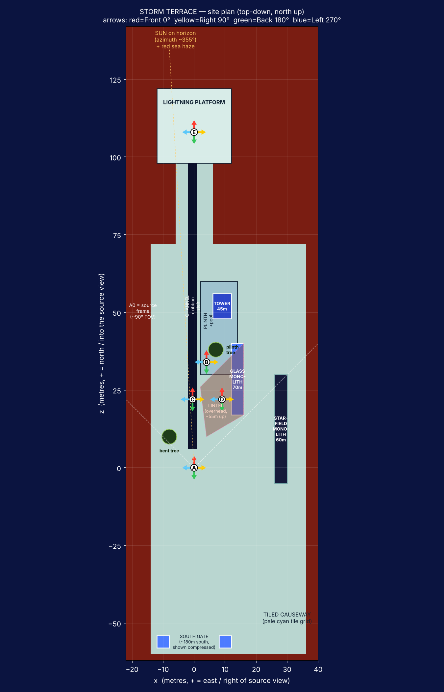

# Storm Terrace — image pack for a navigable World Labs world

Source: the lightning / glass-monolith / tiled-causeway still, cleaned up in
`source/A0_front_source_clean.png`. The video progress bar and red scrub dot
are cropped and inpainted out, so it is now 2000×997.

A single image gives a world model one vantage point. Everything behind the
camera and past the frame edges gets invented, and the result falls apart a
few steps from the start. To get a **large** world you can walk through, we:

1. **Lock a fixed site plan.** `source/site_plan.png` sets where every object
   sits in metres, so all generated views agree with each other.
2. **Generate four directional views (Front/Right/Back/Left) at each of 5
   standing positions ("stations").** We use Google AI Studio's Gemini image
   model, with the source and the plan attached as references.
3. **Feed each station's set to World Labs.** Either build one Marble world
   per station and join them in Studio Compose, or give everything to Atlas
   with the camera poses below.



---

## 0. Conventions (keep these identical for every image)

| Rule | Value |
|---|---|
| Aspect ratio | **16:9 for every image.** Marble's auto-layout breaks when aspect ratios differ |
| Resolution | ≥ 1920×1080 (go higher if the model allows) |
| Camera | eye height 1.6 m above whatever you stand on, **level** (horizon dead-centre vertically), no tilt or roll |
| Field of view | ~90° horizontal, the same wide lens as the source |
| Yaw | 0° = Front/North (into the source image), 90° = Right/East, 180° = Back/South, 270° = Left/West |
| Lighting | sun sitting **on the horizon at azimuth ≈ 355°** (just left of north). North sky is warm red/orange; south sky is deep indigo with first stars. Light rakes in from the north |
| Lightning | one frozen bolt that **touches the far (north) edge of the Lightning Platform**. Show it only where that spot is in frame |
| Never | people, text, logos, UI, letterbox bars, fisheye, tilted horizons, lens flares that hide geometry |

Filenames: `generated/<station><n>_<dir>.png`, e.g. `generated/A1_right.png`.

---

## 1. Paste-in blocks for Google AI Studio

Open AI Studio and pick the Gemini **image generation / editing** model. For
every shot, attach:

1. `source/A0_front_source_clean.png`: the style and geometry ground truth
2. `source/site_plan.png`: the spatial layout
3. 1–2 of the **already-generated neighbouring views** (listed per shot),
   which keeps consistency compounding

Then paste **STYLE + RULES + the SHOT block**.

### STYLE (paste every time)

```
STYLE: A still from a late-1980s / early-1990s Japanese computer-graphics art film — ray-traced, airbrushed, surreal. Ultramarine-to-cobalt sky; torn clouds whose undersides glow molten orange and gold; a band of saturated red-orange haze over a calm sea along the horizon. Architecture is built from glossy pale cyan-white tiles in a tight grid with dark grout, each tile slightly bevelled and specular. Monoliths are slabs of luminous blue glass that look like frozen water-light, streaked vertically with white. Trees are rendered as thousands of tiny pixel-like leaf points — dark green with yellow-green speckle highlights — on twisted, gnarled trunks. Narrow channels hold dark mirror-black water. Soft VHS-era grain. Match the colour palette, tile scale and rendering of the first attached image exactly.
```

### RULES (paste every time)

```
RULES: The first image is the canonical view "A0" (standing at the origin, facing north). The second image is a top-down site plan for spatial reference ONLY — do not draw the plan, labels, arrows or grid. Use the plan's positions and sizes in metres. Camera: eye height 1.6 m, perfectly level, horizon at the vertical centre of the frame, ~90° horizontal field of view, 16:9. The sun sits on the horizon slightly west of north, so northern sky is warm red-orange and southern sky is deep indigo with a few stars. No people, no text, no UI, no letterboxing, no fisheye. Keep every object that is visible in other views at the same position, size and material. STYLE LOCK: the result must look painted by the same hand as the first image, as if it were another frame of the same scanned 35mm transparency — soft airbrushed gradients, visible film grain, slight softness, heavy saturated ultramarine/cobalt dominating the sky, tiles that are mottled aqua-green-white with dark grout and sparkling specular dots (never clean white, never grey), deep blue-black shadows. It must NOT look like a modern photoreal or clean 3D render: no photographic ocean, no realistic sky photo, no lens glare, no plastic-clean surfaces.
```

---

## 2. Shot list

Priority: **Tier 1** gives you a solid single-station world. **Tier 2**
contains the two "look-back" shots (B2, E2), which tie the whole site
together; generate them next. **Tier 3** fills in the rest.

### Station A: The Terrace (x 0, z 0) · Tier 1

**A0_front (0°)**: attach source + plan.
```
SHOT A0_front: Recreate the first image as a clean 16:9 frame at the highest resolution you can. Extend the sky slightly at the top and the tiled causeway slightly at the bottom to reach 16:9; keep the existing composition, objects and colours unchanged. Sharpen tile edges and foliage points without changing the style.
```

**A1_right (90°, facing east)**: attach source + plan + A0.
```
SHOT A1_right: Standing at the same spot as A0, turned 90° right to face EAST. Centre-left, 26 m away and rising out of the top of the frame: the STARFIELD MONOLITH — a 60 m slab whose face is a dark indigo field of dithered blue-white specks (the dark textured slab cut off at the far right edge of A0). At the top-left corner, the brown/terracotta tiled underside of the LINTEL slab cantilevers overhead. The pale cyan tile causeway fills the lower half in strong perspective and ends 36 m away at a clean bevelled edge; beyond it, calm sea under red haze at the horizon. The right half is open causeway receding toward the south. Sky: cobalt with orange-lit cloud undersides; the sunset glow is behind the left edge of frame.
```

**A2_back (180°, facing south)**: attach source + plan + A1.
```
SHOT A2_back: Standing at the same spot as A0, turned around to face SOUTH (away from the sunset). A vast, empty pale-cyan tiled causeway runs straight ahead toward a vanishing point; 180 m away stands the SOUTH GATE — two short luminous blue glass pillars flanking the road. The causeway's right (west) edge drops to calm dark sea; the left side stays open tiles. The sky in this direction is deep indigo-violet with the first faint stars, and cloud undersides still catch orange light from the sun behind the camera. Light rakes from behind the camera, so the tiles glint toward the horizon. Calm, vast, slightly melancholy.
```

**A3_left (270°, facing west)**: attach source + plan + A0.
```
SHOT A3_left: Standing at the same spot as A0, turned 90° left to face WEST. The tiled causeway runs 14 m ahead and ends at a crisp bevelled edge with a sheer drop. Beyond: open calm sea to the horizon, glowing red-orange in a haze band, under a cobalt sky with torn orange-gold clouds. The right side of the horizon is brighter (the sun is just off-frame right). At the top-right corner, the outer branches of the BENT TREE from A0 intrude — the same pixel-leaf foliage. Nothing else stands here: empty, wide, oceanic.
```

### Station B: Tower Plinth (x 4, z 34, standing on the 1.5 m plinth) · Tier 2

**B2_back (180°)**, the most important Tier 2 shot. Attach source + plan + A0 + A1.
```
SHOT B2_back: Standing on the raised tiled plinth beside the plinth tree, facing SOUTH, looking back toward the start point. Left side, very close and rising out of frame: the GLASS MONOLITH (luminous blue glass streaked white), with the brown tiled LINTEL underside across the top-left. Beyond its edge, further left and far: the dark STARFIELD MONOLITH. Centre: the plinth's tiled edge steps down 1.5 m to the causeway, which runs back south. Right of centre: the narrow black-water CHANNEL with its twisting ribbon stair, and 27 m away on the far side of it the BENT TREE from A0, seen from behind. The far distance shows the SOUTH GATE pillars. Indigo sky with first stars; sunlight from behind the camera throws long shadows away from us.
```

**B0_front (0°)**: attach source + plan + A0.
```
SHOT B0_front: On the plinth, facing NORTH. Right of centre, 14–22 m away: the base of the blue glass-tile TOWER, rising out of frame (the tall tower from A0, now close — its tile grid clearly visible). Upper right, very close: the canopy of the PLINTH TREE, its twisted trunk at the right edge. Foreground: a shallow reflecting pool on the plinth mirroring the sky. Left: the black-water CHANNEL and the two tiled walkways running north to the LIGHTNING PLATFORM on the horizon, where the sun sits on the red sea and a lightning bolt strikes the platform's far edge.
```

**B1_right (90°)**: attach plan + B0 + B2.
```
SHOT B1_right: On the plinth, facing EAST. Eight metres ahead, the GLASS MONOLITH fills almost the entire frame — a colossal wall of luminous blue glass streaked vertically with white light, rising out of the top. Across the top, the brown/terracotta tiled LINTEL underside juts out overhead. At the left edge, past the monolith's north end, a slice of cobalt sky with orange clouds. The plinth's tiles and pool edge run to the monolith's foot at the bottom of the frame.
```

**B3_left (270°)**: attach plan + B0 + A3.
```
SHOT B3_left: On the plinth, facing WEST. Foreground: the reflecting pool spills over the plinth's west edge as a thin glassy sheet-waterfall down into the black CHANNEL below. Across the channel: the west tiled walkway, then the causeway's edge and open red-hazed sea to the horizon. The right side of the sky glows warmest (the sun is just off-frame right). Cobalt sky, orange-gold torn clouds. Geometry check: the channel runs LEFT-TO-RIGHT across the frame (north to south), parallel to the image plane, directly below the plinth's edge — it does NOT recede away from the camera. Beyond it the west walkway is a horizontal band, then the sea.
```

### Station E: Lightning Platform (x 0, z 108) · Tier 2

**E2_back (180°)**, the establishing look-back. Attach source + plan + A0 + B0.
```
SHOT E2_back: Standing on the far LIGHTNING PLATFORM, facing SOUTH, looking back at the whole site. Two parallel tiled walkways with the narrow black CHANNEL between them run 40 m back to the main causeway. Left of centre: the raised PLINTH with the PLINTH TREE and the tall blue glass-tile TOWER. Further left and behind: the 70 m GLASS MONOLITH with its brown tiled LINTEL cantilevered from its top, and far behind, the dark STARFIELD MONOLITH. Right of the channel: the BENT TREE on the causeway's edge. The low sun behind the camera floods everything with warm orange-red light and throws long shadows toward the indigo southern sky. Scale check: everything is FAR away — the tower is ~55 m away and fairly small in frame, the glass monolith 70–90 m away, the start point beyond 100 m; the walkways and channel converge strongly toward the middle distance. Left-to-right order across the frame (we face south, so east is on the left): starfield monolith (far left, distant) — glass monolith with lintel — tower and plinth tree — channel (centre) — bent tree (right).
```

**E0_front (0°)** · attach source + plan + A0.
```
SHOT E0_front: On the LIGHTNING PLATFORM, facing NORTH — the edge of the world. The tiled platform ends 14 m ahead at a bevelled edge over calm sea. The sun sits on the horizon just left of centre, inside a blazing red-orange haze band. A frozen lightning bolt descends from the orange-lit clouds and touches the platform's far edge, crackling white-blue. Cobalt sky overhead, gold-edged clouds.
```

**E1_right (90°)** and **E3_left (270°)**: attach plan + E0 + E2.
```
SHOT E1_right: On the LIGHTNING PLATFORM, facing EAST. The platform's tiles run 12 m to its edge; beyond, open calm sea to the horizon. The left side of the horizon is warm red-orange (toward the sun), fading to violet on the right. Torn orange clouds overhead. At the far right edge, the distant top of the STARFIELD MONOLITH. Tile scale is identical to A0: small ~0.5 m tiles, about 25 across the platform's width — never large slabs. The sky overhead is cobalt blue, not brown; red-orange glow only low on the left horizon.
```
```
SHOT E3_left: On the LIGHTNING PLATFORM, facing WEST. The platform's tiles run 12 m to its edge; beyond, open calm sea. The right side of the horizon blazes red-orange (the sun is just off-frame right); the left fades to violet-indigo. Torn orange-gold clouds overhead.
```

### Station D: Under the Lintel (x 9, z 22) · Tier 3

**D0_front (0°)**: attach source + plan + B2.
```
SHOT D0_front: Standing under the cantilevered LINTEL, facing NORTH. The brown/terracotta tiled underside fills the top of the frame overhead. Right edge, 3 m away: the GLASS MONOLITH's face runs forward like a glowing blue wall. Ahead, 8 m away: the plinth's tiled step-up edge; 16 m away, slightly left: the twisted PLINTH TREE, with the TOWER rising behind it. Left: the channel and walkways leading to the sunset horizon.
```
```
SHOT D2_back: Under the LINTEL, facing SOUTH. Left: the glass monolith wall running back to its end; beyond it, the dark STARFIELD MONOLITH. Ahead: the tiled causeway receding to the SOUTH GATE pillars under an indigo sky. Lintel underside across the top. Right side: the black channel, and on the far side of it exactly ONE tree — the BENT TREE, 20 m away. There are NO other trees and NO other towers in this direction; the south is empty, open causeway.
```
```
SHOT D3_left: Under the LINTEL, facing WEST. Lintel underside across the top. Ahead, 9 m away: the black-water CHANNEL with its twisting ribbon stair; beyond it, the west walkway. Left of centre, 20 m away: the BENT TREE silhouetted against the red sea horizon. The right side is warmest (toward the sun).
```

### Station C: In the Channel (x −0.5, z 22, on a stair landing 3 m below deck) · Tier 3

```
SHOT C0_front: Standing on a landing of the twisting ribbon stair INSIDE the narrow channel, 3 m below the causeway, facing NORTH. Tall tiled channel walls converge toward the north; dark mirror water below reflects them. Ribbons of the helix stair twist down into the water. At the far end, a slot of blazing red-orange sunset horizon. Above the right wall, the top of the blue TOWER. A strip of cobalt sky with orange clouds overhead.
```
```
SHOT C2_back: Inside the channel on the stair landing, facing SOUTH. The channel walls converge to a tiled end wall 16 m away where the ribbon stair climbs back up to causeway level. Dark mirror water below. A strip of indigo sky with first stars overhead.
```

---

## 3. Building the world in World Labs

### Route 1: Marble multi-image, one world per station (documented workflow)

1. Upload the station's images (e.g. A0–A3) as a **multi-image prompt**.
2. Click each thumbnail's label and set **Front / Right / Back / Left** to
   match the filename.
3. All images must share the same aspect ratio (they will, at 16:9).
   Non-overlapping views are fine: Marble fills the gaps between them.
4. Generate. Walk it, and if a seam is wrong, regenerate that one view in AI
   Studio rather than fighting it in Marble.
5. Repeat for B, E, D, C.
6. Combine the station worlds in **Studio Compose**, placing each at its
   station offset from the table below (A at the origin, E 108 m north, and so
   on).

### Route 2: Atlas, all images in one shared context

Atlas places multiple images in a single 3D context (from a few to dozens) and
can take camera poses. If your Atlas surface accepts poses, use this table. If
it doesn't, upload the Tier 1 + Tier 2 set and let it solve the poses. Check
the app for current input limits, because availability and input options have
been changing.

| Image | x (m, east) | y eye (m) | z (m, north) | yaw |
|---|---|---|---|---|
| A0_front | 0 | 1.6 | 0 | 0° |
| A1_right | 0 | 1.6 | 0 | 90° |
| A2_back | 0 | 1.6 | 0 | 180° |
| A3_left | 0 | 1.6 | 0 | 270° |
| B0_front | 4 | 3.1 | 34 | 0° |
| B1_right | 4 | 3.1 | 34 | 90° |
| B2_back | 4 | 3.1 | 34 | 180° |
| B3_left | 4 | 3.1 | 34 | 270° |
| C0_front | −0.5 | −1.4 | 22 | 0° |
| C2_back | −0.5 | −1.4 | 22 | 180° |
| D0_front | 9 | 1.6 | 22 | 0° |
| D2_back | 9 | 1.6 | 22 | 180° |
| D3_left | 9 | 1.6 | 22 | 270° |
| E0_front | 0 | 1.6 | 108 | 0° |
| E1_right | 0 | 1.6 | 108 | 90° |
| E2_back | 0 | 1.6 | 108 | 180° |
| E3_left | 0 | 1.6 | 108 | 270° |

Yaw is clockwise seen from above, with 0° = into the source image. If a tool
wants azimuths, Front 0 / Right 90 / Back 180 / Left 270 is the same thing.

### Panorama option

Marble also takes a 2:1 equirectangular panorama per station, as long as its
left and right edges join seamlessly. Gemini doesn't output true
equirectangular images, so stick to the four-view sets unless you have a
stitcher.

---

## 4. Consistency checklist (before uploading)

- [ ] Every image is 16:9, with the horizon at mid-height and no tilt
- [ ] The sun/glow is always toward north: warm side on the correct edge for that yaw
- [ ] Tower, monoliths, lintel and trees keep the same size and material in every view they appear in
- [ ] The tile scale matches A0 (roughly 0.5 m tiles)
- [ ] No text, people, borders or plan artefacts leaked in
- [ ] The lightning bolt appears only in north-facing shots (A0, B0, E0, maybe C0/D0), always at the platform's north edge

`tools/siteplan.py` regenerates the plan if you move anything:
`python3 tools/siteplan.py source/site_plan.png` (needs matplotlib).
